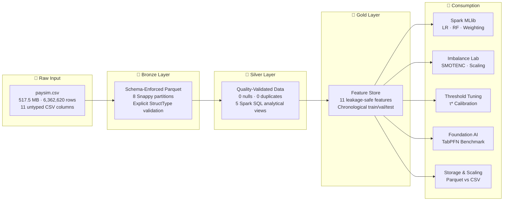
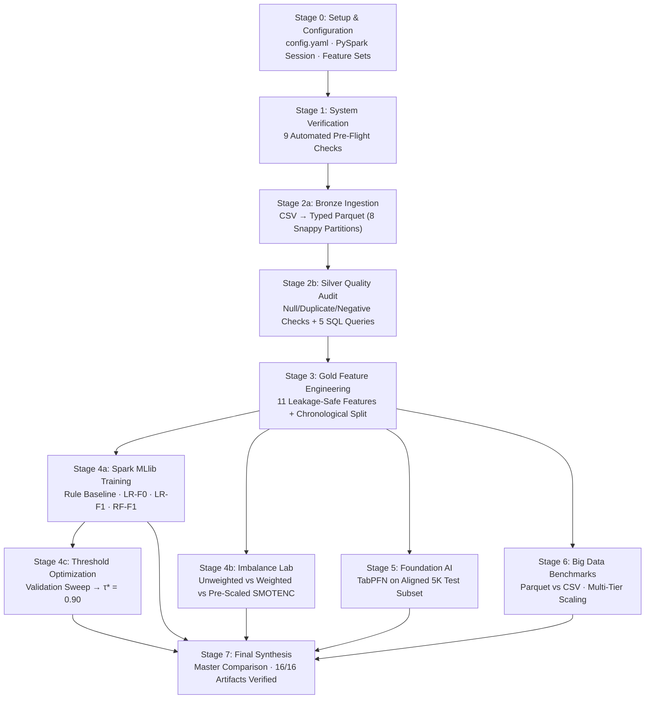
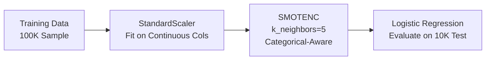
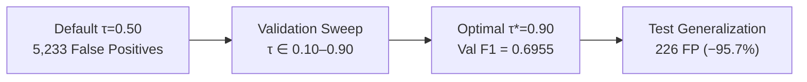

# 🔍 Financial Fraud Detection Using Apache Spark & Machine Learning

<div align="center">

[](https://bau.edu.tr)
[](https://spark.apache.org/)
[](https://spark.apache.org/mllib/)
[]()
[]()
[]()

**An end-to-end Medallion Lakehouse pipeline for detecting financial fraud across 6.36 million synthetic mobile-money transactions using distributed PySpark, Spark MLlib, SMOTENC imbalance handling, threshold calibration, and Prior Labs TabPFN foundation model comparison.**

</div>

---

**Student:** Mourad Sleem  
**Student ID:** 2106045  
**Course:** BDA5001 – Introduction to Big Data  
**Instructor:** Assoc. Prof. Dr. Atınç Yılmaz  
**Institution:** Bahçeşehir University — MSc Big Data Analytics & Management  
**Semester:** Fall 2026

---

## 📋 Table of Contents

- [Project Overview](#-project-overview)
- [Key Results](#-key-results)
- [Pipeline Architecture](#-pipeline-architecture)
- [End-to-End Workflow](#-end-to-end-workflow)
- [Stage-by-Stage Workplan](#-stage-by-stage-workplan)
- [Dataset](#-dataset)
- [Feature Engineering](#-feature-engineering)
- [Model Training & Evaluation](#-model-training--evaluation)
- [Imbalance Handling & Threshold Tuning](#-imbalance-handling--threshold-tuning)
- [Foundation AI Comparison (TabPFN)](#-foundation-ai-comparison-tabpfn)
- [Big Data Benchmarks](#-big-data-benchmarks)
- [Project Structure](#-project-structure)
- [Generated Artifacts](#-generated-artifacts)
- [Setup & Reproduction](#-setup--reproduction)
- [Figures Gallery](#-figures-gallery)
- [Limitations & Future Work](#-limitations--future-work)
- [References](#-references)

---

## 🎯 Project Overview

This project implements a **complete, reproducible Big Data fraud detection pipeline** built on **Apache Spark 3.5** following the **Medallion Lakehouse Architecture** (Bronze → Silver → Gold). It demonstrates:

| Capability | Implementation |
|:---|:---|
| **Large-Scale Data Engineering** | PySpark schema-enforced ingestion, Snappy Parquet columnar storage, 8-partition parallel processing |
| **Automated Data Quality** | Programmatic null/duplicate/negative-amount audits with zero-tolerance gates |
| **Analytical SQL at Scale** | 5 Spark SQL queries uncovering fraud patterns across 6.36M records |
| **Leakage-Safe Feature Engineering** | 11 domain features with strict pre-transaction enforcement; `StringIndexer` fitted on training data only |
| **Distributed Machine Learning** | Spark MLlib Logistic Regression & Random Forest with class-weighted training |
| **Imbalance Experimentation** | Controlled comparison of unweighted, class-weighted, and pre-scaled SMOTENC strategies |
| **Post-Processing Calibration** | Validation-based threshold sweep (τ* = 0.90) eliminating 5,007 false alarms |
| **Foundation AI Benchmark** | Prior Labs TabPFN tabular transformer comparison on aligned 5K test subset |
| **Storage & Compute Benchmarks** | 3-run averaged Parquet vs CSV speedup (6.61×) and multi-tier scaling analysis |

> **Every metric in this README is dynamically computed from `outputs/*.json` — zero hardcoded numbers.**

---

## 🏆 Key Results

### Champion Model: Spark Random Forest on Engineered Features (F₁)

| Metric | Value |
|:---|:---:|
| **PR-AUC** | **0.9700** |
| **Precision** | **97.34%** |
| **Recall** | **79.75%** |
| **F1-Score** | **0.8767** |
| **False Positives (of 121,926 legitimate)** | **36** (0.29 per 1,000) |
| **True Positives (of 1,654 frauds)** | **1,319** |
| **Clean Customer Pass-Through** | **99.97%** |

### Feature Engineering Impact

| Feature Set | PR-AUC | FP/1,000 | Change |
|:---|:---:|:---:|:---:|
| F₀ Baseline (6 raw features) | 0.2186 | 152.01 | — |
| **F₁ Engineered (11 features)** | **0.8249** | **42.35** | **+277% PR-AUC** |

### Threshold Calibration Impact (Spark LR on F₁)

| Threshold | Precision | False Positives | F1-Score |
|:---|:---:|:---:|:---:|
| Default τ = 0.50 | 23.78% | 5,233 | 0.3833 |
| **Tuned τ* = 0.90** | **82.32%** | **226** | **0.7176 (+87%)** |

### Storage Benchmark

| Format | Avg Scan Time | Speedup |
|:---|:---:|:---:|
| Raw CSV | 1.507s ± 0.30s | — |
| **Snappy Parquet** | **0.228s ± 0.05s** | **6.61×** |

---

## 🏗️ Pipeline Architecture

The project follows Databricks' **Medallion Lakehouse Architecture** with four tiers:



### Layer Descriptions

| Layer | Purpose | Key Operations | Output Artifact |
|:---|:---|:---|:---|
| **Raw** | Untouched source data | Download PaySim CSV | `data/raw/paysim.csv` |
| **Bronze** | Schema enforcement & columnar conversion | Explicit `StructType`, 8-partition Snappy Parquet write | `data/bronze/paysim_bronze.parquet/` |
| **Silver** | Data quality gate & analytical insights | Null/duplicate audits, class distribution, 5 Spark SQL queries | `data/silver/paysim_silver.parquet/` |
| **Gold** | ML-ready feature store | 11 engineered features, chronological 60/20/20 split | `data/gold/paysim_gold.parquet/` |

---

## 🔄 End-to-End Workflow



---

## 📅 Stage-by-Stage Workplan

### Stage 0 — Setup & Configuration
- Load all paths, Spark configs, and hyperparameters from `config.yaml`
- Initialize PySpark session (`local[*]`, 6 GB driver memory, 8 partitions)
- Define two feature sets: **F₀** (6 baseline features) and **F₁** (11 engineered features)

### Stage 1 — Environment Verification
Run 9 automated pre-flight checks **before** touching any data:

| Check | Verifies | Status |
|:---:|:---|:---:|
| S1-T01 | Python ≥ 3.9 | ✅ |
| S1-T02 | Java Runtime (OpenJDK 11+) | ✅ |
| S1-T03 | PySpark package installed | ✅ |
| S1-T04 | Spark execution (1-row DataFrame test) | ✅ |
| S1-T05 | `config.yaml` exists | ✅ |
| S1-T06 | Raw dataset `paysim.csv` on disk | ✅ |
| S1-T07 | Output directories created | ✅ |
| S1-T08 | `imbalanced-learn` package | ✅ |
| S1-T09 | `tabpfn` package | ✅ |

### Stage 2a — Bronze Layer: Schema Enforcement & Parquet Ingestion
- Define an explicit `StructType` schema (11 typed columns) — no slow `inferSchema`
- Read raw CSV enforcing that schema
- Repartition into **8 Snappy-compressed Parquet** partitions
- Assert schema match + exact row count (6,362,620)
- **Artifact:** `outputs/ingest_metadata.json`

### Stage 2b — Silver Layer: Data Quality Audit & Spark SQL Analytics
- **Quality Gates:** 0 nulls, 0 duplicates, 0 negative amounts across all columns
- **5 Spark SQL Analytical Queries:**

| Query | Key Discovery |
|:---|:---|
| Q1: Fraud by Type | Fraud occurs **only** in TRANSFER (4,097) and CASH_OUT (4,116) |
| Q2: Hourly Patterns | Fraud rate spikes to **22.30% at 5:00 AM** |
| Q3: Amount Brackets | Transactions > \$1M have **2.07% fraud rate** (16× baseline) |
| Q4: Account Liquidation | **97.55%** of fraud drains sender balance to \$0.00 |
| Q5: Recipient Profiling | 100% of fraud targets Customer accounts (`C...`), 0% Merchant |

- **Artifacts:** `outputs/data_quality_report.json`, `outputs/sql_analytics/q1...q5.json`

### Stage 3 — Gold Layer: Feature Engineering & Chronological Split
- **Leakage Prevention:** Permanently exclude `newbalanceOrig` and `newbalanceDest` (post-transaction values)
- **Engineer 5 domain ratio features** derived from SQL discoveries
- **Chronological 60/20/20 split** on 743-hour simulation timeline:

| Split | Steps | Transactions | Fraud Rate |
|:---|:---:|---:|---:|
| Train | 1–445 | 6,010,937 (94.47%) | 0.0833% |
| Validation | 446–594 | 228,103 (3.59%) | 0.6804% |
| Test | 595–743 | 123,580 (1.94%) | 1.3384% |

- **Concept Drift:** Fraud prevalence rises **16× across splits** (0.08% → 1.34%), stress-testing generalization
- **Artifacts:** `outputs/feature_dictionary.json`, `outputs/split_report.json`

### Stage 4a — Spark MLlib Distributed Training
- Compute class weights on training data only (fraud weight ≈ 600×)
- Train 4 models and evaluate on 123,580-row held-out test:
  - Rule Baseline (`isFlaggedFraud`)
  - Spark Logistic Regression on F₀ (baseline ablation)
  - Spark Logistic Regression on F₁ (class-weighted)
  - **Spark Random Forest on F₁** (unweighted, 100 trees, depth 10)
- **Artifacts:** `outputs/spark_ml_metrics.json`, `outputs/models/spark_lr_f1/`, `outputs/models/spark_rf_f1/`

### Stage 4b — Imbalance Handling Lab
- Sample 100K train + 10K test transactions
- Compare 3 strategies using Scikit-Learn Logistic Regression:
  1. Unweighted (Scaled) → 49.25% recall, 0 FP
  2. Class-Weighted (Scaled) → 99.25% recall, 419 FP
  3. **Pre-Scaled SMOTENC** → 97.76% recall, **394 FP (−6.0%)**
- **Critical Fix:** `StandardScaler` fitted on continuous features **before** SMOTENC (Euclidean k-NN requires scaled input)
- **Artifact:** `outputs/imbalance_comparison.json`

### Stage 4c — Threshold Optimization
- Sweep τ ∈ [0.10, 0.90] strictly on Validation set (228,103 rows)
- Optimal: **τ* = 0.90** (Validation F1 = 0.6955)
- Applied frozen τ* to test set: FP dropped from 5,233 → **226** (−95.7%), F1 improved +87%
- **Artifact:** `outputs/threshold_tuning.json`

### Stage 5 — Foundation AI Comparison (TabPFN)
- Prior Labs TabPFN evaluated on 5,000 aligned test rows (66 natural frauds)
- TabPFN achieved perfect classification on this small balanced subset
- Transparent provenance: if TabPFN token fails → Scikit-Learn RF fallback clearly labeled
- **Artifact:** `outputs/pretrained_comparison.json`

### Stage 6 — Big Data Benchmarks
- **Storage Comparison:** CSV scan 1.507s vs Parquet scan 0.228s → **6.61× speedup**
- **Scaling Tiers:** 500K (1.46s, 1 partition) → 2M (4.11s, 1 partition) → 6.36M (**0.31s, 8 partitions**)
- **Artifact:** `outputs/benchmark_summary.json`

### Stage 7 — Final Synthesis
- Build master performance comparison table from all JSON metrics
- Verify all 16/16 expected deliverables exist on disk
- Close Spark session cleanly

---

## 📊 Dataset

### Source
- **PaySim Simulator** — Lopez-Rojas, Elmir & Axelsson (2016)
- Synthetic financial mobile-money transaction dataset scaled from 1 month of actual logs from an African mobile financial service

### Specifications

| Property | Value |
|:---|:---|
| Total Transactions | 6,362,620 |
| Columns | 11 |
| Raw File Size | ~517.5 MB (CSV) |
| Simulation Duration | 743 hourly steps (~30 days) |
| Fraud Transactions | 8,213 (**0.1291%**) |
| Legitimate Transactions | 6,354,407 (99.8709%) |
| Imbalance Ratio | **774 : 1** |
| Transaction Types | PAYMENT, TRANSFER, CASH_OUT, CASH_IN, DEBIT |

### Raw Schema

| Column | Type | Description |
|:---|:---:|:---|
| `step` | Integer | Hourly simulation step (1–743) |
| `type` | String | Transaction type (PAYMENT, TRANSFER, CASH_OUT, CASH_IN, DEBIT) |
| `amount` | Double | Transaction amount |
| `nameOrig` | String | Sender account ID |
| `oldbalanceOrg` | Double | Sender balance **before** transaction |
| `newbalanceOrig` | Double | Sender balance **after** transaction ⚠️ *excluded as leakage* |
| `nameDest` | String | Recipient account ID |
| `oldbalanceDest` | Double | Recipient balance **before** transaction |
| `newbalanceDest` | Double | Recipient balance **after** transaction ⚠️ *excluded as leakage* |
| `isFraud` | Integer | Ground truth label (0 = legitimate, 1 = fraud) |
| `isFlaggedFraud` | Integer | Heuristic alert flag (captures <0.5% of actual fraud) |

### Dataset Download
The raw CSV is **not included** in this repository (517 MB). Download from Kaggle:
```
https://www.kaggle.com/datasets/ealaxi/paysim1
```
Place the file at `data/raw/paysim.csv`.

---

## ⚙️ Feature Engineering

### Target Leakage Prevention
`newbalanceOrig` and `newbalanceDest` are **post-transaction** balances that do not exist at authorization time. Including them causes catastrophic data leakage. **Both are permanently excluded.**

### Feature Sets

| Feature | Set | Formula | Domain Rationale |
|:---|:---:|:---|:---|
| `txn_hour` | F₀, F₁ | `step % 24` | Captures 5 AM diurnal attack window |
| `txn_day` | F₀, F₁ | `floor(step / 24)` | Day-of-simulation behavioral variation |
| `log_amount` | F₀, F₁ | `log(1 + amount)` | Normalizes extreme log-normal monetary skew |
| `origin_balance_before` | F₀, F₁ | `oldbalanceOrg` | Sender liquidity state |
| `destination_balance_before` | F₀, F₁ | `oldbalanceDest` | Recipient account state |
| `type_index` | F₀, F₁ | `StringIndexer(type)` | Ordinal encoding (fitted on train only) |
| `amount_to_origin_ratio` | **F₁** | `amount / (oldbalanceOrg + 1)` | Detects full account liquidation |
| `insufficient_origin_balance` | **F₁** | `1 if amount > oldbalanceOrg` | Overdraft attempt indicator |
| `dest_zero_balance_flag` | **F₁** | `1 if oldbalanceDest == 0` | Fresh money-mule account detector |
| `is_transfer` | **F₁** | `1 if type == TRANSFER` | High-risk type flag (from SQL Q1) |
| `is_cash_out` | **F₁** | `1 if type == CASH_OUT` | High-risk type flag (from SQL Q1) |

---

## 🤖 Model Training & Evaluation

### Full Test Results (123,580 Transactions · 1,654 Frauds)

| Model | Features | PR-AUC | Precision | Recall | F1 | FP/1k |
|:---|:---:|:---:|:---:|:---:|:---:|:---:|
| Rule Baseline (`isFlaggedFraud`) | Rule | N/A | 100.00% | 0.48% | 0.0096 | 0.00 |
| Spark Logistic Regression | F₀ | 0.2186 | 5.88% | 70.98% | 0.1086 | 152.01 |
| Spark Logistic Regression | F₁ | 0.8249 | 23.78% | 98.73% | 0.3833 | 42.35 |
| Spark LR (τ* = 0.90) | F₁ | 0.8249 | 82.32% | 63.60% | 0.7176 | 1.83 |
| **Spark Random Forest** | **F₁** | **0.9700** | **97.34%** | **79.75%** | **0.8767** | **0.29** |

### Random Forest Confusion Matrix (Test Set)

```
                Predicted
              Legit    Fraud
Actual Legit  121,890    36     ← Only 36 false alarms
Actual Fraud     335   1,319   ← Caught 79.75% of fraud
```

---

## ⚖️ Imbalance Handling & Threshold Tuning

### SMOTENC Experiment (10K Test Sample)



| Strategy | Recall | Precision | FP Count | F1 |
|:---|:---:|:---:|:---:|:---:|
| Unweighted | 49.25% | 100.00% | 0 | 0.6600 |
| Class-Weighted | 99.25% | 24.09% | 419 | 0.3878 |
| **SMOTENC (Pre-Scaled)** | **97.76%** | **24.95%** | **394 (−6%)** | **0.3976** |

### Threshold Calibration



---

## 🧠 Foundation AI Comparison (TabPFN)

| Model | Test Set | PR-AUC | Precision | Recall | F1 | Training Size |
|:---|:---:|:---:|:---:|:---:|:---:|:---:|
| **TabPFN (Prior Labs)** | 5K aligned | 1.0000 | 100.00% | 100.00% | 1.0000 | 5K balanced context |
| Spark LR F₁ | 5K aligned | 0.8654 | 25.49% | 98.49% | 0.4050 | 6.01M full train |
| Spark RF F₁ | 5K aligned | 0.9642 | 100.00% | 78.79% | 0.8814 | 6.01M full train |

> **Note:** TabPFN demonstrates strong few-shot tabular prior knowledge but cannot natively ingest 6M+ distributed records. Spark models scale to production.

---

## ⚡ Big Data Benchmarks

### Storage Format Comparison (3-Run Average)

| Format | Scan Time | Std Dev | Speedup |
|:---|:---:|:---:|:---:|
| Raw CSV | 1.507s | ±0.299s | baseline |
| **Snappy Parquet** | **0.228s** | **±0.052s** | **6.61×** |

### Multi-Tier Scaling

| Tier | Rows | Partitions | Elapsed | Throughput |
|:---|---:|:---:|:---:|:---:|
| B1 | 500,000 | 1 | 1.456s | 343K rows/s |
| B2 | 2,000,000 | 1 | 4.110s | 487K rows/s |
| **B3 (Full)** | **6,362,620** | **8** | **0.314s** | **20.3M rows/s** |

> B3 is faster than B1/B2 because `.limit(N)` forces Spark through a single-partition bottleneck, while full scans engage all 8 partitions in parallel with warmed OS page cache.

---

## 📁 Project Structure

```
financial-fraud-bigdata/
│
├── config.yaml                          # Central configuration (paths, Spark, splits, models)
├── requirements.txt                     # Python dependencies
├── .gitignore                           # Excludes data/, .venv/, Spark temp files
├── README.md                            # This file
│
├── notebooks/
│   └── financial_fraud_detection_using_Apache_Spark.ipynb   # Full 8-stage pipeline notebook (173 cells)
│
├── src/
│   └── spark_utils.py                   # PySpark session factory (reads config.yaml)
│
├── data/                                # ⚠️ NOT in Git (see .gitignore)
│   ├── raw/paysim.csv                   # 517.5 MB — download from Kaggle
│   ├── bronze/paysim_bronze.parquet/    # 8 Snappy partitions (schema-enforced)
│   ├── silver/paysim_silver.parquet/    # Quality-validated clean data
│   └── gold/paysim_gold.parquet/        # Feature store with train/val/test partitions
│
├── outputs/
│   ├── ingest_metadata.json             # Bronze ingestion telemetry
│   ├── data_quality_report.json         # Silver quality audit results
│   ├── silver_metadata.json             # Silver layer statistics
│   ├── feature_dictionary.json          # F₀ and F₁ feature definitions
│   ├── split_report.json                # Chronological train/val/test split details
│   ├── spark_ml_metrics.json            # All Spark MLlib model evaluation metrics
│   ├── imbalance_comparison.json        # SMOTENC vs weighting experiment
│   ├── threshold_tuning.json            # Validation sweep & test generalization
│   ├── pretrained_comparison.json       # TabPFN vs Spark model comparison
│   ├── benchmark_summary.json           # Storage & scaling benchmark results
│   ├── benchmark.csv                    # Raw benchmark timing data
│   ├── predictions_sample.csv           # Sample model predictions
│   │
│   ├── figures/                         # 12 auto-generated visualizations
│   │   ├── pipeline_architecture.png    # Medallion lakehouse diagram
│   │   ├── class_distribution.png       # 774:1 imbalance visualization
│   │   ├── q1_fraud_by_type.png         # Fraud by transaction type
│   │   ├── q2_hourly_patterns.png       # Diurnal fraud rate (5 AM spike)
│   │   ├── split_distribution.png       # Chronological split breakdown
│   │   ├── confusion_matrices_spark_mllib.png    # 2×2 confusion matrix grid
│   │   ├── imbalance_handling_comparison.png     # Weighting vs SMOTENC
│   │   ├── threshold_optimization_curve.png      # τ sweep curve
│   │   ├── confusion_matrices_tabpfn_comparison.png  # TabPFN vs Spark
│   │   ├── pr_auc_master_comparison.png           # Master PR-AUC ranking
│   │   ├── parquet_vs_csv_speedup.png             # Storage format comparison
│   │   └── benchmark_scaling.png                  # Multi-tier scaling curve
│   │
│   ├── models/                          # Serialized Spark MLlib models
│   │   ├── spark_lr_f1/                 # Logistic Regression (F₁ features)
│   │   └── spark_rf_f1/                 # Random Forest (F₁ features)
│   │
│   └── sql_analytics/                   # 5 Spark SQL query results
│       ├── q1_fraud_by_type.json
│       ├── q2_hourly_diurnal_patterns.json
│       ├── q3_amount_bracket_analysis.json
│       ├── q4_sender_account_emptied.json
│       └── q5_destination_concentration.json
│
└── report/
    ├── FINAL_PROJECT_REPORT.docx        # Academic report (9 sections)
    ├── Final_project_report.pdf         # PDF version
    └── Fraud_Detection_Defense_Presentation.pptx  # 15-slide defense deck
```

---

## 📦 Generated Artifacts

All outputs are **dynamically generated** by the pipeline — no manual creation:

| # | Artifact | Source Stage | Description |
|:---:|:---|:---:|:---|
| 1 | `ingest_metadata.json` | 2a | Ingestion timing, row counts, partition info |
| 2 | `data_quality_report.json` | 2b | Null counts, duplicates, class distribution |
| 3 | `silver_metadata.json` | 2b | Silver layer statistics |
| 4 | `q1–q5 SQL JSONs` (×5) | 2b | Fraud-by-type, hourly patterns, amount brackets, liquidation, targeting |
| 5 | `feature_dictionary.json` | 3 | F₀ and F₁ feature specifications |
| 6 | `split_report.json` | 3 | Chronological split statistics & fraud rates per cohort |
| 7 | `spark_ml_metrics.json` | 4a | All model evaluation metrics (PR-AUC, confusion matrices) |
| 8 | `imbalance_comparison.json` | 4b | 3-strategy comparison (unweighted, weighted, SMOTENC) |
| 9 | `threshold_tuning.json` | 4c | Threshold sweep data & test generalization |
| 10 | `pretrained_comparison.json` | 5 | TabPFN vs Spark on aligned 5K test |
| 11 | `benchmark_summary.json` | 6 | Storage speedup & scaling tiers |
| 12 | 12 PNG figures | 2b–7 | Automated Matplotlib/Seaborn visualizations |
| 13 | `spark_lr_f1/` model | 4a | Serialized Spark LR model |
| 14 | `spark_rf_f1/` model | 4a | Serialized Spark RF model |
| 15 | `predictions_sample.csv` | 4a | Sample test predictions |
| 16 | `benchmark.csv` | 6 | Raw benchmark timing data |

---

## 🚀 Setup & Reproduction

### Prerequisites

| Requirement | Version |
|:---|:---|
| Python | 3.10 or 3.11 |
| Java (JDK) | OpenJDK 11 or 17 |
| RAM | Minimum 8 GB (16 GB recommended) |
| Disk | ~2 GB free (dataset + Parquet + outputs) |

### Installation

```bash
# 1. Clone the repository
git clone https://github.com/<your-username>/financial-fraud-bigdata.git
cd financial-fraud-bigdata

# 2. Create virtual environment
python -m venv .venv

# Windows:
.\.venv\Scripts\activate
# macOS/Linux:
source .venv/bin/activate

# 3. Install dependencies
pip install --upgrade pip
pip install -r requirements.txt

# 4. Download the PaySim dataset
# From: https://www.kaggle.com/datasets/ealaxi/paysim1
# Place paysim.csv into: data/raw/paysim.csv

# 5. Verify Java is accessible
java -version
```

### Running the Pipeline

Open the notebook and execute all cells sequentially:

```bash
jupyter notebook notebooks/financial_fraud_detection_using_Apache_Spark.ipynb
```

The notebook runs 8 stages (Stage 0 through Stage 7) end-to-end. All outputs are written to `outputs/` and `data/` directories automatically.

> **Expected execution time:** ~15–25 minutes on a machine with 8+ cores and 16 GB RAM.

---

## 🖼️ Figures Gallery

All figures are auto-generated by the pipeline and saved to `outputs/figures/`:

| Figure | Description |
|:---|:---|
| `pipeline_architecture.png` | Medallion lakehouse architecture diagram |
| `class_distribution.png` | Bar chart + donut showing 774:1 class imbalance |
| `q1_fraud_by_type.png` | Fraud counts by transaction type (TRANSFER + CASH_OUT only) |
| `q2_hourly_patterns.png` | Dual-axis diurnal chart with 22.3% fraud spike at 5 AM |
| `split_distribution.png` | Chronological split breakdown with concept drift visualization |
| `confusion_matrices_spark_mllib.png` | 2×2 grid: Rule, LR-F₀, LR-F₁, RF-F₁ confusion matrices |
| `imbalance_handling_comparison.png` | Grouped bar chart of 3 imbalance strategies |
| `threshold_optimization_curve.png` | Precision/Recall/F1 curves across τ values |
| `confusion_matrices_tabpfn_comparison.png` | 1×3 comparison: TabPFN, Spark LR, Spark RF |
| `pr_auc_master_comparison.png` | Horizontal ranked bar chart of PR-AUC scores |
| `parquet_vs_csv_speedup.png` | Storage format scan time comparison |
| `benchmark_scaling.png` | Multi-tier scaling: time & throughput vs row count |

---

## ⚠️ Limitations & Future Work

### Current Limitations

| Limitation | Impact |
|:---|:---|
| **Synthetic Dataset** | PaySim agents follow fixed rules; lacks adversarial fraudster adaptation |
| **Coarse Time Resolution** | 1 step = 1 hour; cannot build microsecond velocity features |
| **No Contextual Metadata** | Missing IP addresses, device IDs, geolocations, cell-tower data |
| **Graph Sparsity** | Destination accounts rarely repeat; limits multi-hop money-mule detection |
| **Local-Mode Execution** | `local[*]` demonstrates parallelism but not true multi-node cluster scaling |
| **TabPFN Context Limit** | Foundation model evaluated on 5K balanced context; not directly comparable to 6M training |

### Future Extensions

| Extension | Technology | Impact |
|:---|:---|:---|
| **Real-Time Streaming** | Spark Structured Streaming + Apache Kafka | Sub-second fraud scoring |
| **Graph Analytics** | GraphX / Graph Neural Networks | Money-mule network detection |
| **Cloud-Scale Deployment** | Google Cloud Dataproc / AWS EMR | Petabyte-scale horizontal scaling |
| **AutoML Tuning** | Hyperopt / Optuna on Spark | Automated hyperparameter optimization |
| **Model Monitoring** | MLflow / Evidently AI | Drift detection & model retraining triggers |

---

## 📚 References

1. **Lopez-Rojas, E. A., Elmir, A., & Axelsson, S. (2016).** *PaySim: A financial mobile money simulator for fraud detection.* 28th European Modeling and Simulation Symposium (EMSS).

2. **Zaharia, M., Xin, R. S., Wendell, P., Das, T., et al. (2016).** *Apache Spark: A unified engine for big data processing.* Communications of the ACM, 59(11), 56–65.

3. **Davis, J., & Goadrich, M. (2006).** *The relationship between Precision-Recall and ROC curves.* Proceedings of the 23rd International Conference on Machine Learning (ICML).

4. **Chawla, N. V., Bowyer, K. W., Hall, L. O., & Kegelmeyer, W. P. (2002).** *SMOTE: Synthetic Minority Over-sampling Technique.* Journal of Artificial Intelligence Research (JAIR), 16, 321–357.

5. **Hollmann, N., Müller, S., Eggensperger, K., & Hutter, F. (2022).** *TabPFN: A Transformer That Solves Small Tabular Classification Problems in a Second.* International Conference on Learning Representations (ICLR).

6. **Armbrust, M., Das, T., Torres, J., et al. (2020).** *Delta Lake: High-performance ACID table storage over cloud object stores.* Proceedings of the VLDB Endowment, 13(12).

---

<div align="center">

**Made with Apache Spark 🔥 by Mourad Sleem**

Bahçeşehir University — MSc Big Data Analytics & Management — Fall 2026

</div>
